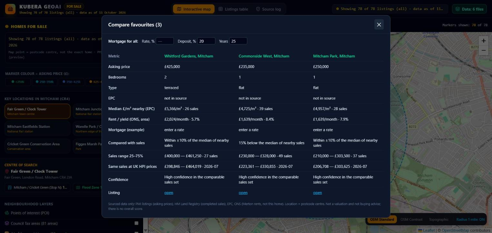

# KUBERA GeoAI — Mitcham property evidence map

**An interactive map of homes for sale in Mitcham (CR4), London, shown next to real, sourced evidence: completed sales, energy certificates, flood zones and neighbourhood context.**

### [▶ Open the live demo — kubera-geoai.pages.dev](https://kubera-geoai.pages.dev)

KUBERA GeoAI does not invent a valuation. For every home it shows **what the public evidence says, how strong that evidence is, and what is missing.**

---

## What it does

**Prices and market evidence**
- **78 homes for sale** in Mitcham (CR4) on one map, coloured by asking price.
- **Comparison with completed sales** (HM Land Registry): same property type within 1 km, typical range (25th–75th percentile) and a plain-English verdict, only when there are at least 5 sales.
- **Evidence confidence**: high / limited / insufficient, with duplicate registry rows flagged.
- **UK House Price Index**: the same sales re-expressed at the latest published index month. Original prices are never replaced.
- **Price per m²** from EPC floor area (exact address matches only), plus a **£/m² map layer** in 400 m squares.

**Location context**
- **Environment Agency flood zones 2 and 3** (rivers and sea) as a map layer and in every home card.
- **What's nearby**: nearest stations (TfL), state schools with their latest Ofsted outcome, GP, supermarket and park (OpenStreetMap). Distances are straight-line only.

**Tools**
- Area rent and gross yield (ONS, Merton), mortgage example with your own rate.
- Compare up to 3 favourite homes side by side.
- A shareable link to each home, and a print / PDF dossier.
- Works on desktop and mobile.

## Screenshots

| | |
|---|---|
| **Home card: price, sources, flood risk, what's nearby**  | **Evidence from completed sales, UK HPI, £/m²**  |
| **£/m² from completed sales (400 m squares)**  | **Environment Agency flood zones 2 and 3**  |

**Side-by-side comparison of favourite homes**

## Data sources

| Source | Used for | Licence |
|---|---|---|
| HM Land Registry Price Paid Data | Completed sales | Open Government Licence v3.0 |
| HM Land Registry UK House Price Index | Index adjustment (Merton, by property type) | Open Government Licence v3.0 |
| MHCLG Energy Performance Certificates | Floor area, energy band | Open Government Licence v3.0 |
| ONS Price Index of Private Rents | Area rents (Merton) | Open Government Licence v3.0 |
| Environment Agency Flood Map for Planning | Flood zones 2 and 3 (rivers and sea) | Open Government Licence v3.0 |
| Transport for London Unified API | Stations | Powered by TfL Open Data (OGL v2) |
| Ofsted management information | School inspection outcomes | Open Government Licence v3.0 |
| OpenStreetMap | Map, amenities | © OpenStreetMap contributors, ODbL |

Contains HM Land Registry data © Crown copyright and database right. Contains Environment Agency information © Environment Agency and database right. The data providers do not endorse this project.

## Honest limitations

- **Location = postcode centre**, not the exact building. Distances and flood results are approximate.
- **£/m² only where the EPC matches the exact address**; the floor area of homes for sale is not published, so it is never assumed.
- **Flood zones** cover rivers and sea only, ignore defences and do not include surface-water risk.
- **Rents are area medians** for Merton, not the rent of a specific home.
- **Listings are a snapshot** dated 11 October 2026; prices and availability may have changed.
- Missing data is shown as missing, never filled in.

**This is a research tool, not a valuation, survey, mortgage or investment advice.**

## Status

Working prototype, Mitcham (CR4), London. This repository is a public showcase; the application source code is private.

## Contact

GitHub: [jobkubera-lab](https://github.com/jobkubera-lab) · Live demo: [kubera-geoai.pages.dev](https://kubera-geoai.pages.dev)
