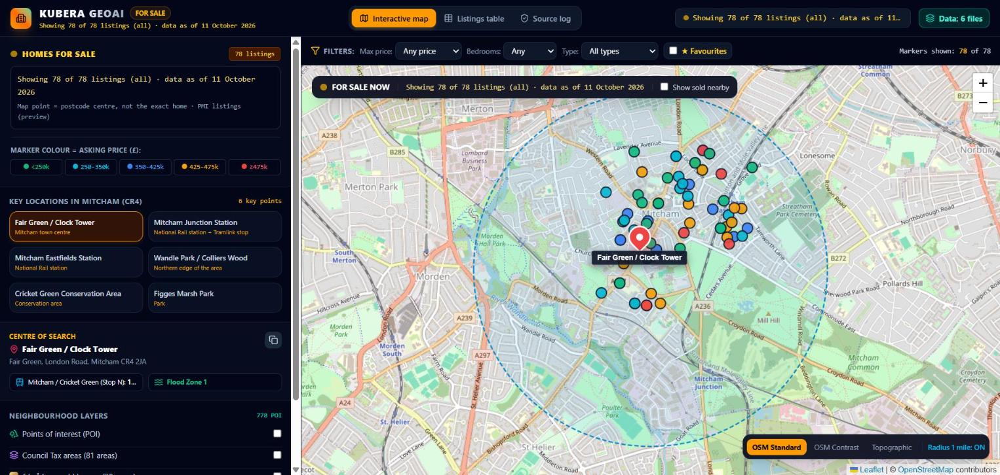
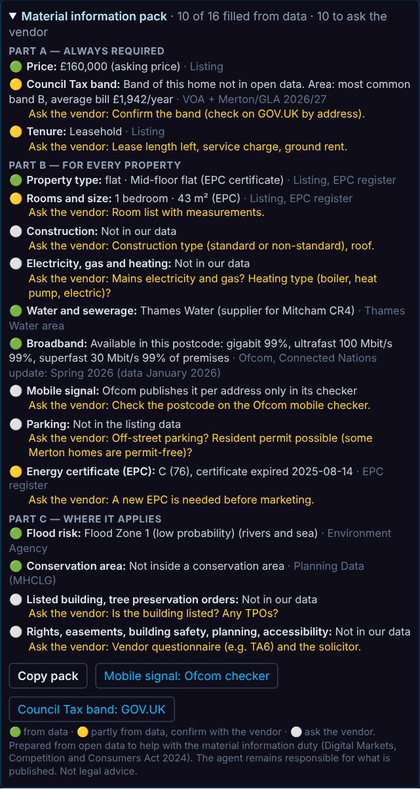
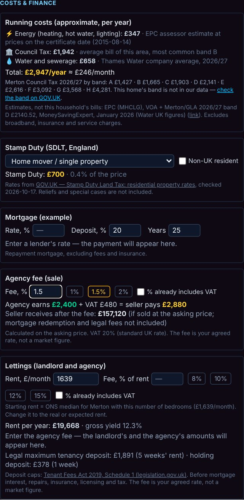
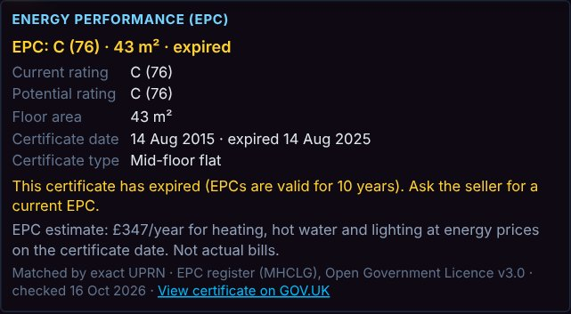
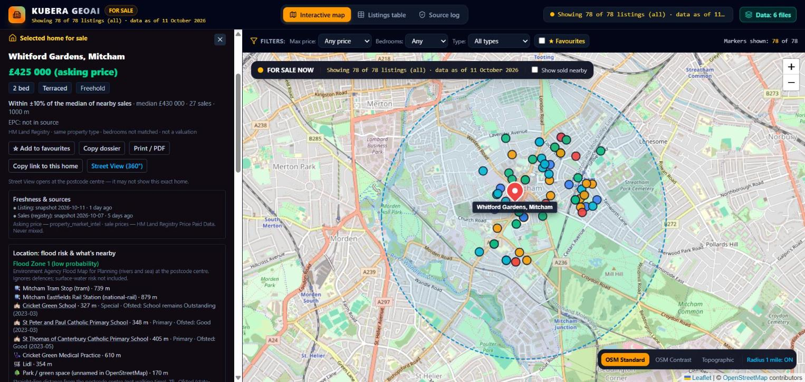
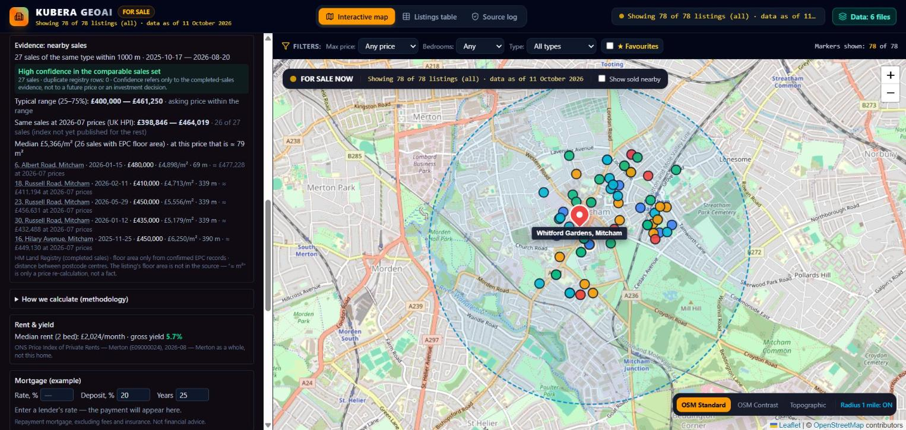
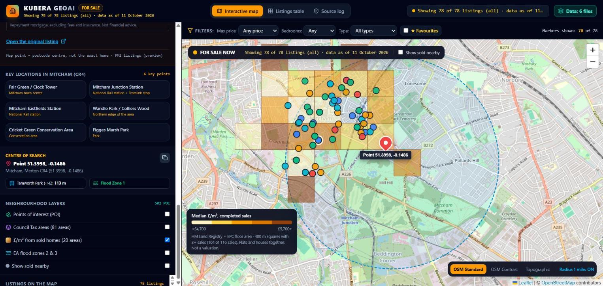
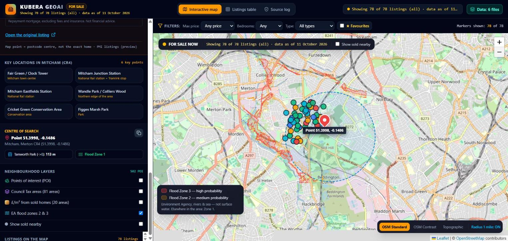
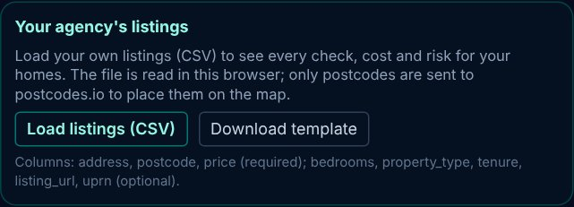

# KUBERA GEO SI — property evidence for UK estate agents

**A map-based tool that prepares the facts an estate agent needs for each home: exact location, energy certificate, Material Information, costs, flood and planning context — all from open government data, with the source next to every figure.**

### [▶ Open the live demo — kubera-geoai.pages.dev](https://kubera-geoai.pages.dev) · [Русская версия](https://kubera-geoai.pages.dev/?lang=ru)

Pilot area: Mitcham (CR4), London Borough of Merton.



KUBERA GEO SI does not invent valuations or scores. For every home it shows **what the public data says, where it comes from, and what still has to be asked from the seller.**

---

## Why agents need it

Since April 2025 every property advert in the UK must give buyers the key facts about the home (*material information* under the Digital Markets, Competition and Consumers Act 2024): Council Tax, tenure, utilities, broadband, parking, flood risk, planning restrictions and more. Agents usually collect this by hand — often an hour per home.

KUBERA GEO SI fills in everything that open data can answer and turns the rest into a short list of questions for the seller.

## What it does

**For the agency**
- **Material Information pack** in every home card — Part A / B / C, each line marked *from data*, *partly from data* or *ask the seller*, with one-click copy.
- **Load your own listings (CSV)** — the agency's file is read in the browser; only postcodes are sent for geocoding. Every check and cost then runs on the agency's own homes.
- **Data checks** across all listings — stale snapshots, duplicate adverts, homes without an exact address, conflicting property type, expired energy certificates, missing tenure.
- **Agency fee and lettings** — sale commission with or without VAT, landlord's rent after fees, legal deposit caps (Tenant Fees Act 2019).
- **English / Russian interface** with one switch.



**Facts about each home**
- **Exact map point** from the Unique Property Reference Number (OS Open UPRN) where the listing provides it, otherwise the postcode centre — always labelled.
- **Energy certificate (EPC) matched by UPRN** — band, floor area, certificate date, expiry warning and a link to the official certificate.
- **Broadband availability** for the postcode (Ofcom Connected Nations) and a link to the Ofcom mobile checker.
- **Flood risk** — Environment Agency flood zones (rivers and sea) and surface-water risk.
- **Conservation areas** (Planning Data, MHCLG).
- **Nearby** — stations, schools with Ofsted outcome, GP, shops, parks.

**Costs and finance (estimates, clearly marked)**
- Running costs: energy (from the EPC), Council Tax for the area by band, water.
- Stamp Duty (current GOV.UK rates: first-time buyer, additional property, non-UK resident).
- Mortgage example with the lender's own rate.



**Market evidence**
- Asking prices compared with completed sales (HM Land Registry) of the same type within 1 km, only when there are enough sales.
- UK House Price Index adjustment, price per m² from EPC floor area, £/m² map layer.

## Screenshots

| | |
|---|---|
| **Data checks over all listings**  | **Energy certificate matched by UPRN**  |
| **Home card: price, sources, flood risk, nearby**  | **Evidence from completed sales**  |
| **£/m² from completed sales**  | **Flood zones 2 and 3**  |
| **Agency listings upload**  | **Russian interface**  |

## How it is built (high level)

```
Open government data ──► weekly refresh (GitHub Actions) ──► checked, versioned JSON snapshots
                                                                   │
Agency CSV (in the browser) ──► postcode geocoding ────────────────┤
                                                                   ▼
                                   React + TypeScript map application (Cloudflare Pages)
                                   ├─ matching by UPRN (location, EPC)
                                   ├─ rule-based data checks
                                   ├─ Material Information builder
                                   └─ cost calculators (published rates only)
```

- **Front end:** React, TypeScript, Vite, Tailwind CSS, Leaflet / OpenStreetMap.
- **Data pipeline:** Python, scheduled weekly; every snapshot carries its source, licence and retrieval date.
- **Quality:** type checks, unit tests for every calculator and rule, browser tests in English and Russian on desktop and mobile before each release.
- **Principles:** no invented numbers, missing data shown as missing, every figure linked to its source.

The application source code is private. This repository is a public showcase.

## Data sources

| Source | Used for | Licence |
|---|---|---|
| HM Land Registry Price Paid Data, UK HPI | Completed sales, index adjustment | Open Government Licence v3.0 |
| Ordnance Survey OS Open UPRN | Exact property points | Open Government Licence v3.0 |
| MHCLG Energy Performance Certificates | Energy band, floor area, certificate date | Open Government Licence v3.0 |
| Ofcom Connected Nations | Broadband availability by postcode | © Ofcom |
| Environment Agency | Flood zones, surface-water risk | Open Government Licence v3.0 |
| Planning Data (MHCLG) | Conservation areas | Open Government Licence v3.0 |
| VOA, Merton Council, GLA | Council Tax bands and charges | Open Government Licence v3.0 |
| GOV.UK, legislation.gov.uk | Stamp Duty rates, Tenant Fees Act caps | Open Government Licence v3.0 |
| ONS Price Index of Private Rents | Area rents | Open Government Licence v3.0 |
| Transport for London Unified API | Stations | Powered by TfL Open Data |
| Ofsted | School inspection outcomes | Open Government Licence v3.0 |
| OpenStreetMap | Base map, amenities | © OpenStreetMap contributors, ODbL |

Contains HM Land Registry, Ordnance Survey and Environment Agency data © Crown copyright and database right. Broadband data © Ofcom (Connected Nations). The data providers do not endorse this project.

## Honest limitations

- One pilot area (Mitcham, CR4). Other areas need their data loaded.
- No direct CRM connection yet: agencies export listings from their CRM as CSV.
- The Council Tax band of a single address is not open data — the tool shows the area and links to the official GOV.UK check.
- Ofcom publishes mobile signal per address only in its own checker, so the tool links to it.
- Costs are estimates from published averages, not household bills.
- **This is a preparation tool for agents, not legal advice, a valuation, a survey or financial advice. The agent remains responsible for what is published.**

## Contact

Nikola Kubera, London · GitHub: [kubera-lab](https://github.com/kubera-lab) · Live demo: [kubera-geoai.pages.dev](https://kubera-geoai.pages.dev)

Open to pilots with estate agencies and roles in property data / GIS.

## Where things live

| What | Where |
|---|---|
| Live product | https://kubera-geoai.pages.dev |
| This repository | public showcase: description, screenshots, docs — no application code |
| Application code | private (`kubera-local-ai`, branch `gemini/ui`, folder `apps/geoai-ui`) |
| Hugging Face | https://huggingface.co/spaces/Dzambala/kubera-geoai — static showcase page |

## Licence

All rights reserved — see [LICENSE](LICENSE). Data shown keeps its own licence (mostly Open Government Licence v3.0).
